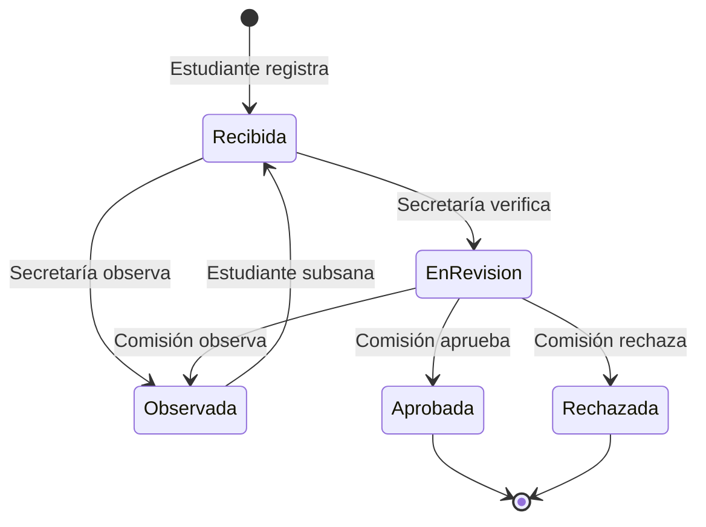

# Sistema de Convalidación de Asignaturas FIA–EPICS

Demo universitaria del curso **Gestión de Procesos · Universidad de San Martín de Porres (USMP)**.

Aplicación ASP.NET Core MVC con Razor, Bootstrap local, CSS y JavaScript; .NET 10, Entity Framework Core 10 y SQLite. Sin autenticación. Los perfiles se simulan por sesión y cualquier visitante puede cambiarlos. **Solo datos ficticios; las decisiones no tienen validez administrativa.**

Repositorio esperado: <https://github.com/jodach34/DEMO-LUCIANA.git>.

## Ejecutar localmente

Requisitos: SDK .NET 10 estable; Git. Docker es opcional para comprobar el contenedor. `global.json` admite las bandas estables del SDK 10.0, incluido el 10.0.400 instalado durante la implementación.

Desde la raíz:

```powershell
dotnet restore --locked-mode
dotnet tool restore
dotnet build --no-restore
dotnet test --no-build
dotnet run --project src/Convalidacion.Web --launch-profile http
```

Abre <http://localhost:5283>. El inicio aplica las migraciones y crea cuatro asignaturas ilustrativas y cinco solicitudes, una por estado, si no existe catálogo. SQLite local se guarda en `src/Convalidacion.Web/App_Data/convalidacion.db`, fuera de Git. Las fechas del historial se muestran en UTC.

Los paquetes y sus dependencias quedan registrados en `packages.lock.json`. Para actualizar versiones, modifica las referencias, ejecuta `dotnet restore`, revisa los locks y vuelve a probar.

## Recorrido de la demo

1. Con **Estudiante**, crea una solicitud para una asignatura de destino. Usa un nombre ficticio, curso de origen, créditos, nota y coincidencia simulada. Confirma los dos documentos de ejemplo.
2. Cambia a **Secretaría** y abre el expediente. Inicia la revisión o registra una observación.
3. Con **Comisión académica**, aprueba, observa o rechaza una solicitud en revisión. Cada decisión exige sustento.
4. Una observación permite al **Estudiante** registrar una subsanación. El expediente vuelve a recibido para una nueva verificación de Secretaría.
5. Consulta el historial y filtra la bandeja por estado, nombre ficticio, asignatura o número de expediente (por ejemplo, `1`). El panel muestra conteos reales de la base; no simula ahorros ni tiempos medidos.



Reglas **didácticas**, no normativa oficial de la USMP: nota mínima 11/20, coincidencia mínima de 80% y créditos de origen iguales o superiores a los del destino. El registro admite solicitudes con criterios insuficientes para demostrar la evaluación y rechazo. La coincidencia se ingresa como dato simulado; no se calcula a partir de un sílabo.

Alcance: una asignatura por expediente; lista documental simulada, sin carga de archivos; subsanación mediante comentario, sin edición de notas o créditos; decisiones finales inmutables desde la interfaz. Los visitantes comparten los expedientes ficticios. La bandeja muestra las 100 solicitudes más recientes que cumplen el filtro.

## Organización

```text
src/Convalidacion.Web/
  Controllers/       Acciones HTTP y validación de formularios
  Models/            Entidades, enumeraciones y modelos de las vistas
  Services/          Reglas del proceso y perspectiva de perfil simulado
  Data/              DbContext, migraciones y datos de demostración
  Views/             Razor y componentes parciales
  wwwroot/           Bootstrap/jQuery locales, CSS y JavaScript
tests/Convalidacion.Tests/
  SolicitudServiceTests.cs   Reglas del proceso con SQLite real en memoria
  WebTests.cs                Integración HTTP con MVC, cookies y antiforgery
```

Se usa directamente EF Core desde servicios y consultas MVC, sin repositorios genéricos ni capas adicionales. Cada cambio guarda estado e historial en la misma operación transaccional. Un token de concurrencia impide sobrescribir una revisión más reciente. El perfil simulado no constituye un control de acceso de producción.

Validación del navegador y del servidor; antiforgery en POST; redirecciones limitadas a rutas locales; páginas para errores y HTTP 404; logs de consola con identificadores y estados, sin registrar nombres ni contenido del expediente. `/health` comprueba conectividad SQLite. Los recursos visuales se sirven localmente.

## Migraciones y configuración

```powershell
dotnet tool restore
dotnet ef migrations list --project src/Convalidacion.Web
dotnet ef database update --project src/Convalidacion.Web
dotnet ef migrations has-pending-model-changes --project src/Convalidacion.Web
# Después de modificar un modelo:
dotnet ef migrations add NombreDelCambio --project src/Convalidacion.Web --output-dir Data/Migrations
```

`MigrateAsync` al iniciar es una decisión para esta demo de una instancia. Para una aplicación con datos duraderos o varias réplicas, diseña una estrategia de migración separada y persistencia externa. Consulta la [documentación de EF Core](https://learn.microsoft.com/en-us/ef/core/managing-schemas/migrations/applying).

| Configuración | Desarrollo | Producción / Docker |
| --- | --- | --- |
| `ConnectionStrings:DefaultConnection` | `App_Data/convalidacion.db` relativo al proyecto | `/tmp/convalidacion/convalidacion.db` |
| `Demo:SeedData` | `true` | `true` |
| `ASPNETCORE_ENVIRONMENT` | `Development` en launch profile | `Production` |
| `PORT` | Sin definir; launch profile 5283 | Puerto suministrado por Render |

Las variables de entorno sustituyen los valores JSON usando doble guion bajo, por ejemplo `ConnectionStrings__DefaultConnection` y `Demo__SeedData`. Para iniciar sin ejemplos, define `Demo__SeedData=false` antes del primer arranque con una base vacía. No elimina ejemplos ya existentes.

El sembrado es determinista e idempotente: conserva las solicitudes creadas por visitantes en una base existente. Para una demostración nueva, detén la aplicación y usa una ruta de base SQLite nueva mediante la variable de conexión. No borres una base que quieras conservar.

No se necesitan contraseñas ni claves. No agregues secretos, bases SQLite, archivos `.env` o credenciales de producción al repositorio. Conserva las licencias de las librerías incluidas en `wwwroot/lib`.

## Docker y Render Free

```powershell
docker build -t convalidacion-demo .
docker run --rm -p 8080:8080 -e PORT=8080 convalidacion-demo
```

Abre <http://localhost:8080> y <http://localhost:8080/health>. Imagen multi-stage SDK/ASP.NET 10; publicación Release; proceso sin root; sin volúmenes o discos de pago. Kestrel escucha `0.0.0.0` cuando existe `PORT`. Render termina HTTPS en su proxy; la aplicación no fuerza redirecciones desde el HTTP interno.

Para desplegar después de publicar la versión estable en `main`:

1. Conecta tu cuenta de GitHub a Render y autoriza **exactamente** `jodach34/DEMO-LUCIANA`.
2. Crea un Blueprint usando `render.yaml`, o un Web Service con runtime Docker, rama `main`, Dockerfile `./Dockerfile`, contexto raíz y plan **Free**.
3. Mantén `ASPNETCORE_ENVIRONMENT=Production`, la conexión SQLite de `/tmp` y `/health` como comprobación de salud.
4. No agregues discos persistentes. El Blueprint solicita despliegue después de pasar los checks de GitHub; verifica que la integración esté activa.
5. Revisa logs de migración/arranque, `/health` y el recorrido funcional en la URL asignada.

Render Free pierde el sistema de archivos al reiniciar, redesplegar o suspender por inactividad. La base y las sesiones son temporales; los ejemplos se reconstruyen al arrancar con un disco vacío. Puede haber espera al reactivar el servicio. Esto es adecuado para la demo, no para expedientes reales. Ver [límites oficiales de Render Free](https://render.com/docs/free) y [Blueprints](https://render.com/docs/blueprint-spec).

## Git e integración continua

- `main`: versión estable y desplegable.
- `develop`: integración.
- `feature/*`: nuevas funcionalidades; esta demo se implementó en `feature/demo-convalidacion`, creada desde `develop`.
- `fix/*`: correcciones concretas; crea una rama desde `develop` cuando corresponda. `*` expresa una convención, no un nombre literal de rama.

Integra mediante pull request: feature/fix → develop → main. Evita `push --force`. Antes de cualquier publicación, verifica el remoto de lectura y escritura:

```powershell
git remote -v
git remote get-url origin
git remote get-url --push origin
git fetch origin
git status --short --branch
```

El destino debe ser exactamente `https://github.com/jodach34/DEMO-LUCIANA.git`. Si aparecen commits remotos, intégralos sin sobrescribir el historial. La publicación y las protecciones de rama necesitan acceso a la cuenta de GitHub; no están implícitas en los archivos locales.

`.github/workflows/ci.yml` restaura en modo bloqueado, compila Release con advertencias como errores, ejecuta las pruebas si hay proyectos de prueba, revisa migraciones y conserva resultados TRX. Otro job construye Docker y prueba `/health` y `/` usando `PORT=10000`.

## Verificación de la implementación

Consulta [docs/VERIFICACION.md](docs/VERIFICACION.md) para los resultados observados y las limitaciones. La existencia del workflow no demuestra que GitHub Actions haya ejecutado los checks: debe verificarse tras publicar el repositorio.
